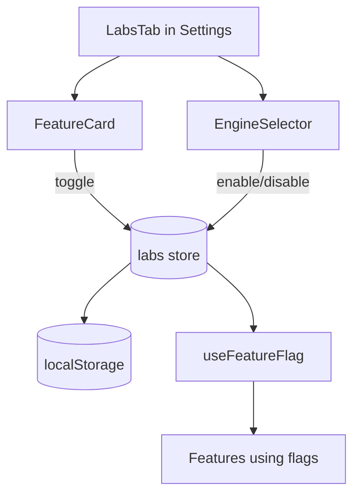

# Labs

Early features. A flag lives here while a feature is still changing; shipping the feature means deleting its flag.



## Where things live

- **Definitions**: `src/core/labs/features.ts`
- **Store**: `src/core/store/labs.ts`
- **Hook**: `src/shared/hooks/useFeatureFlag.ts`
- **Surface**: `src/shell/Modals/SettingsModal/tabs/LabsTab/LabsTab.tsx`. To deep-link it, dispatch `open-settings-modal` with `{ tab: 'labs' }`.

## Components

- **FeatureCard** - One flag's card and toggle
- **FeatureStatusBadge** - Status indicator (early access/beta)
- **EngineSelector** - Segmented control over the 3D-engine kernel flag (`brepkit_kernel`); replaces `FeatureCard` UI for it

## Current Flags

Internal status enum values → UI badge labels: `experimental` → "Early access", `preview` → "Beta".

| Flag                       | Status (`enum`) | Purpose                                                            |
| -------------------------- | --------------- | ------------------------------------------------------------------ |
| `brepkit_kernel`           | `experimental`  | Alternative 3D geometry engine (BrepKit), driven by EngineSelector |
| `show_generation_perf`     | `experimental`  | Per-stage generation timing overlay in the bin designer            |
| `community_fits_gap`       | `experimental`  | Select a layout gap and browse community designs that fit it       |
| `sliding_tray`             | `experimental`  | Rail-and-tray sliding insert in the bin designer's Walls section   |
| `workshop`                 | `experimental`  | Part-based Workshop builder: 3D editor, exact export, library sync |
| `spacemouse`               | `experimental`  | 3Dconnexion SpaceMouse navigation in the 3D previews               |
| `slant`                    | `experimental`  | Bins that lean, with slanted rows and an end support               |
| `places`                   | `experimental`  | Bin contents, Find across layouts, and folders as places           |
| `community_showcase`       | `preview`       | Publish and remix bin designs in the community showcase            |
| `designer_settings_search` | `preview`       | Search every bin-designer control from the panel                   |

Kernel selection priority in `BridgeManager`/`WorkerPoolManager` is `brepkit > default (occt-wasm)`.

## Usage

```typescript
const isEnabled = useFeatureFlag('show_generation_perf');
```

Recipes for adding, graduating and removing a flag are in the `analytics-and-labs` skill.
