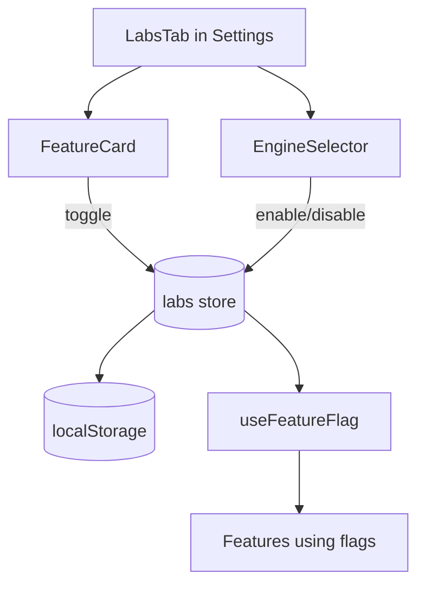

# Labs

Early features. A flag lives here while a feature is still changing; shipping the feature means deleting its flag.



## Where things live

- **Definitions**: `src/core/labs/features.ts`
- **Store**: `src/core/store/labs.ts`
- **Hook**: `src/shared/hooks/useFeatureFlag.ts`
- **Surface**: `src/shell/Modals/SettingsModal/tabs/LabsTab/LabsTab.tsx`. To deep-link it, dispatch `open-settings-modal` with `{ tab: 'labs' }`.

## Components

- **FeatureCard** - One flag's card and toggle
- **EarlyAccessBadge** - The "Early access" chip
- **EngineSelector** - Segmented control over the 3D-engine kernel flag (`brepkit_kernel`); replaces `FeatureCard` UI for it

## Current Flags

| Flag                   | Purpose                                                            |
| ---------------------- | ------------------------------------------------------------------ |
| `brepkit_kernel`       | Alternative 3D geometry engine (BrepKit), driven by EngineSelector |
| `show_generation_perf` | Per-stage generation timing overlay in the bin designer            |
| `sliding_tray`         | Rail-and-tray sliding insert in the bin designer's Walls section   |
| `spacemouse`           | 3Dconnexion SpaceMouse navigation in the 3D previews               |
| `slant`                | Bins that lean, with slanted rows and an end support               |
| `places`               | Bin contents, Find across layouts, and folders as places           |

Kernel selection priority in `BridgeManager`/`WorkerPoolManager` is `brepkit > default (occt-wasm)`.

## Usage

```typescript
const isEnabled = useFeatureFlag('show_generation_perf');
```

Recipes for adding, graduating and removing a flag are in the `analytics-and-labs` skill.
