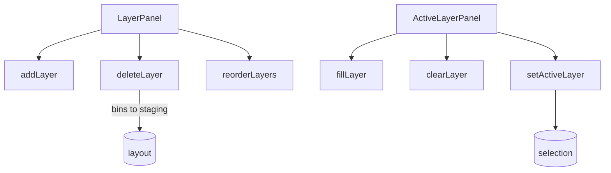

# Layers

Vertical stacking system for multi-height drawer organization.

## Key Files

- `components/LayerPanel.tsx` — layer list with add/delete/reorder, drag-and-drop reordering
- `components/ActiveLayerPanel.tsx` — active layer controls (fill, clear, paint mode)

## Z-Axis Model (CRITICAL)

`layers[0]` is the bottom; the UI reverses via `getDisplayLayers()`. A layer is
stacking order only: each bin rests on the tallest lower-layer bin under its
footprint, or the plate (`resolveRestingStack()` in `@/shared/utils/restingStack`).
Layer height is the default for new bins and moves nothing.

## Gotchas

1. **Bottom-left coordinate system** - Y=0 is bottom, layers[0] is bottom
2. **Blocked zones** - only clearance a lower bin reserves; tall bins just carry what is above
3. **Reorder validation** - refuses a reorder that stacks past the drawer top
4. **Can't delete last layer** - minimum 1 required
5. **Layer deletion** - bins move to staging

## Help Modal Integration

`helpEntries` is exported from the barrel and aggregated by the global Help modal. Add new entries to `helpEntries.ts` when authoring user-facing affordances that should be discoverable via natural-language search. Each entry's `target` references a `data-help-target` marker in the rendered DOM.
